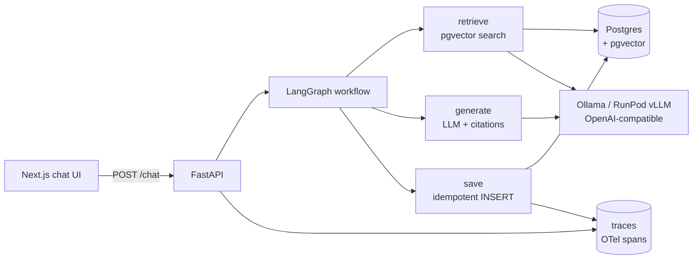

# SecAnswer — Security Questionnaire Response Assistant

An AI assistant that answers customer **security questionnaires** using your own
documents — grounded, cited, and version-aware. Built as a full-stack AI system:
**FastAPI + LangGraph + PostgreSQL/pgvector + Next.js**, running a local
open-weights LLM (Ollama) with a clean path to cloud deployment.

## Why this project exists

Four problems make naive "chat-with-my-docs" demos useless in production:

1. **Stale answers** — retrieval pulls the closest *vector*, not the *current*
   document, so an old policy version can beat the new one by a hair.
2. **Untrusted citations** — page numbers get hallucinated or drift when
   documents are re-chunked.
3. **Duplicate writes** — when a request times out *after* the DB committed, an
   agent retry inserts the row twice.
4. **No observability** — when a tool call fails, there's no trace of why.

This project designs all four out from the start, and proves it with an eval
suite. The engineering is the point; the "chatbot" is the shell.

## Architecture



```
Next.js (chat UI)
    │  POST /chat
    ▼
FastAPI
    │  question + thread_id
    ▼
LangGraph workflow
    ├─ retrieve   → embed query → pgvector search (version-filtered)
    ├─ generate   → prompt LLM with retrieved chunks + citation metadata
    └─ save       → idempotent INSERT (UNIQUE run_id, ON CONFLICT DO NOTHING)
    │
    └── Ollama (open weights, OpenAI-compatible)  ·  Postgres + pgvector
```

Ingestion is a separate script: parse PDF/Markdown → chunk (page/section-aware)
→ embed → upsert, flipping the previous version to `is_current = false` in one
transaction.

## The four craft items (what this repo demonstrates)

| Problem | Solution | Where |
|---|---|---|
| Stale documents | `documents.is_current` + partial unique index + `WHERE is_current` retrieval | `schema.sql`, `retrieval.py` |
| Wrong citations | page/section captured from the parser, returned as metadata, model forbidden from inventing pages | `ingest.py`, `text.py` |
| Duplicate writes | `run_id` idempotency key + `UNIQUE(run_id)` + `ON CONFLICT DO NOTHING` | `schema.sql`, `graph.py` |
| No observability | OpenTelemetry spans → Postgres `traces` table + `/traces` endpoint | `tracing.py`, `graph.py` |

## Local quickstart

```bash
# 0. Prerequisites: Ollama + Python 3.12 (Postgres via Docker, or native)
ollama pull llama3.1:8b nomic-embed-text

# 1. One-command demo: db + schema + ingest v1/v2 + eval suite
./scripts/demo.sh

# 2. Backend
cd backend
python3.12 -m venv .venv && source .venv/bin/activate
pip install -r requirements.txt
cp ../.env.example .env
uvicorn app.main:app --reload

# 3. Frontend
cd ../frontend
cp .env.local.example .env.local
pnpm install && pnpm dev
```

Open http://localhost:3000 and ask a question. To import a whole questionnaire,
`POST /questionnaire` (see `data/sample_questionnaire.json`).

## API

| Endpoint | Purpose |
|---|---|
| `POST /chat` | single-question answer with citations |
| `POST /questionnaire` | batch-draft every question |
| `POST /questionnaire/export` | batch-draft → CSV |
| `GET /answers` | list drafts for review |
| `POST /answers/{run_id}/review` | mark reviewed / store edited answer |
| `GET /traces` | OpenTelemetry spans (observability) |

## Verified results

- **Unit tests:** 20/20 pass (`make test`).
- **Eval suite: ALL PASS** — version filtering (returns v2, never v1), answer
  grounding (7-year / 180-day answers, not the stale 1-year / 90-day), and
  idempotent save (two runs → one row).
- **Honest abstention:** an out-of-scope question ("Do you encrypt data at
  rest?") returns *"the excerpts do not mention…"* instead of a hallucination.
- **Trace tree** for one query: `workflow (1.27s) → retrieve (0.12s) / generate
  (1.13s) / save (4ms)`, with failed tool calls captured as `error` spans.

## Deployment (v2 — cloud)

Same code, different env vars. See [`deploy/DEPLOY.md`](deploy/DEPLOY.md):

- **GPU (LLM):** RunPod Serverless / vLLM (OpenAI-compatible).
- **DB:** managed Postgres + pgvector (Supabase / Neon / RDS).
- **Backend:** the [`backend/Dockerfile`](backend/Dockerfile) on Fly.io / Railway / Render.
- **Frontend:** Next.js on Vercel.

## Roadmap

- [x] v1 local MVP (single-question chat)
- [x] Batch questionnaire import (draft every answer)
- [x] Human-in-the-loop review/edit step
- [x] Evals + tracing (OpenTelemetry → Postgres)
- [ ] v2 cloud deployment (GPU + managed Postgres + object storage)

## Status

✅ **Local product complete and verified.** Chat + batch questionnaire + review
+ export + tracing all work end-to-end on local hardware (macOS Apple M5, and
identically on an RTX 3060). Remaining: the cloud deployment (v2).
